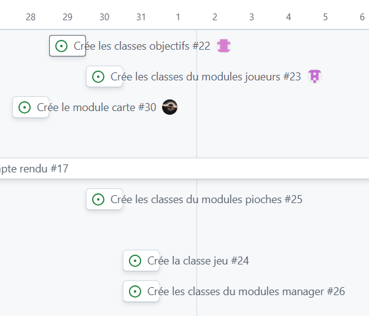
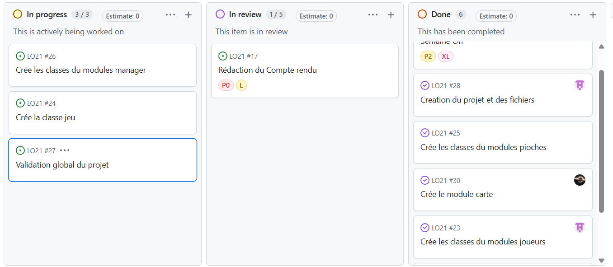

# Compte Rendu 2 - Projet Codex Naturalis

**Date de rendu :** Semaine du 3 novembre  
**Auteur responsable du livrable :** Victor Pottier 
**Membres du groupe :**
1. Ulysse Virlogeux--Chabaille
2. Hans Vinçon
3. Victor Pottier
4. Zeineb Mokded

---

## 1. Tâches réalisées au cours de cette 2e phase

L'objectif principal est de définir une architecture théorique suffisamment complète pour permettre, durant la phase 3, d'implémenter un premier prototype de Codex Naturalis jouable sur terminal.

### 1.1 Description de l'architecture UML
Pour réaliser cette UML nous nous sommes inspirer du TD SET.

### 1.2 Tableau récapitulatif des tâches réalisées

| ID | Tâche Macro | Complexité estimée | Durée estimée | Responsable (Affectation a priori) | Date de réalisation
| :--- | :--- | :--- | :--- | :--- | :--- |
| T1 | Définition plus approfondie de l'UML décrivant l'architecture du projet | Élevée | 4h | Hans Vinçon - Zeineb Mokded | 19/10/2026
| T1bis | Réunion et discussions autour de l'UML afin de le valider | Faible | 1h30 | Tous les membres | 26/10/2026
| T2 | Mise en place d'un environnement Github et Discord pour l'organisation du travail | Moyenne | 2h | Ulysse Virlogeux--Chabaille | 26/10/2026
| T3 | Programmation d'un premier modèle pour la classe abstraite Carte et de ses dépendances | Moyenne | 4h30 | Ulysse Virlogeux--Chabaille - Hans Vinçon| 30/10/2026
| T4 | Création d'un premier modèle de classe pour CarteObjectif et ConditionScore | Moyenne | 2h | Zeineb Mokded | 31/10/2026
| T5 | Rédaction du deuxième compte-rendu | Élevée | 3h | Victor Pottier | 06/11/2026
| T6 | Rectifications et validation du deuxième compte-rendu | Moyenne | 1h / membre | Tous les membres | 07/11/2026

---

## 2. Bilan sur la cohésion de groupe et l'implication

**État de la cohésion :**

Pour des questions d'organisation, le groupe a mis en place un serveur discord, afin de retrouver au mieux l'information relative aux tâches à effectuer (système d'annonce par ticket), à l'information à inclure dans le compte-rendu, etc....;

L'affectation des tâches s'est réalisée à travers Github comme prévu dans le premier compte-rendu.

Les mouvements sociaux et le report des examens médians ont généré une pression supplémentaire qui nous a contraint à réajuster l'organisation du groupe.

L'architecture du projet étant établie, un travail de programmation considérable reste à faire jusqu'au prochain compte-rendu.

**Implication des membres :**

**!!!!ICI remplissez vous-même la partie qui vous concerne, j'ai écrit vite fait quelques idées rapides mais vous être libres et responsables de modifier et ré-écrire proprement tout ce qui vous concerne!!!!!**

* **Ulysse Virlogeux--Chabaille** : Annonce des tâches à réaliser à travers Discord et organisation du projet. L'implication dans la programmation n'as pas non plus été négligé puisqu'il est celui qui s'est chargé de la création du .h de carte et de la plus part de ses dépendances.
* **Hans Vinçon** : Développement de l'UML. Déclaration et définition des classes filles de la classe Carte. 
* **Victor Pottier** : Rédaction du compte-rendu. Ne disposant pas de Visual Studio ni de CodeBlocks sur son ordinateur personnel, des installations seront à prévoir rapidement en anticipation du fort travail de programmation qui devra être réalisé.
* **Zeineb Mokded** :Participation à l'amélioration et à la mise à jour du diagramme UML, notamment pour mieux représenter les mécanismes du jeu et faciliter son implémentation. Développement de la classe CarteObjectif et  de l'énumération TypeObjectif, ainsi que de la structure abstraite ConditionScore.

Bilan : très bonne entente du groupe, la prise de décision peut toutefois être ralentie du fait des médians reportés plusieurs fois et des priorités de chacun. Une solide base organisationnelle a été posée, ce qui facilitera la programmation plus poussée du projet.

---

## 3. Etat d'avancement par rapport au Compte Rendu 1

Le point le plus important concerne la définition plus poussée de l'architecture théorique du projet.

En effet, l'UML associé à cette architecture a été davantage détaillé lors de cette 2e phase du projet. Notamment, les associations et les héritages entre les classes du projet ont été proprement explicités.

Pour réaliser ce diagramme UML nous nous sommes inspirés du TD SET. 
Voici une description détaillée des différentes relations entre les classes : 

* Compositions :
    * Les **CarteDePLacement** (**CarteDorure**, **CarteRessource**, **CarteDepart**) possèdent des coins vides ou remplis. De plus, nous considérons que la **CarteDePlacement** est responsable du cycle de vie. Nous avons donc choisis de créer une composition entre **CarteDePlacement** et **Coins**. La cardinalité est 4 du côté de **Coins** et 1 du côté de **CartePlacement** puisque nous considérons qu’un **Coin** est forcément associé à une seule et unique carte.
    * La classe **Plateau** compose la classe **Joueur**. Nous avons choisis que **Plateau** ne pouvait pas vivre indépendamment de la classe **Joueur**.
    * Un objet **CartePlacee** est placé sur un objet **Plateau**, il ne peut donc pas exister sans le plateau associé, d’où la relation de composition entre **Plateau** et **CartePlacee**.
    * L’objet **Manager** est un objet particulier qui contrôle le déroulement de la partie. Une de ses tâches est de notamment assurer la destruction de tous les objets instanciés nécessaires pour jouer la partie une fois que cette dernière se termine. Ainsi, **Manager** gère le cycle de vie des classes **Jeu, PiocheRessource, PiocheDepart, PiocheObjectif, PiocheDorure**, et **Joueur**, impliquant une relation de composition avec ces classes. La destruction de ces classes suffit pour détruire tous les objets du jeu grâce aux autres compositions que nous avons défini.
    * L’objet **Tybor** est instancié uniquement en mode solo et doit, comme tous les autres objets, être détruit en fin de partie via la classe **Manager**. Ainsi, il existe une relation de composition entre le **Manager** particulier **ManagerSolo** et la classe **Tybor**.

* Agrégations  :
    * Etant donné que les pioches contiennent des cartes mais que le cycle de vie de celles-ci est géré par la classe Jeu, les classes pioches **PiocheRessource**, **PiocheDorure**, **PiocheDepart**, et **PiocheObjectif** sont liés par une agrégation avec les classes **CarteRessource**, **CarteDorure**, **CarteDepart** et **CarteObjectif** respectivement.
    * La classe **Joueur** possède une main de cartes de placement, c’est donc une relation d’agrégation qui lie la classe **Joueur** à la classe **CarteDePlacement**

* Héritage : 
    * Les classes **CarteRessource**, **CarteDorure** et **CarteDepart** sont des cartes de placement particulières, elles héritent donc de la classe abstraite **CarteDePlacement**. 
    * La classe abstraite **CarteDePlacement** est elle même une carte, donc elle hérite d’une classe plus générale Carte, tout comme la classe **CarteObjectif**.
    * De manière similaire, les classes PiocheRessource, **PiocheDorure**, **PiocheDepart**, et **piocheObjectif** sont des pioches particulières, elles héritent donc de la classe abstraite Pioche.
    * Enfin, vu que deux modes de jeu sont disponibles (solo ou multijoueur), on divise la classe Manager en 2 sous-classes pour chacun des 2 modes de jeu : **ManagerMulti** et **ManagerSolo** héritent donc de la classe **Manager**.

* Associations simples : les classes suivantes ne sont pas liées par une relation de possession, ce sont donc des associations simples et non des agrégations :
    * Un **Coin** _contient_ éventuellement une **Ressource** ou un **Objet**
    * De même les classes **CarteDorure** et **CarteObjectif** _contiennent_ une **ConditionScore**
    * Une **CartePlacee** _référence_ une **CarteDePlacement**
    * La classe **Manager** _rend visible_ deux instances de chacune des classes CarteRessource, CarteDorure, et CarteObjectif
    * La classe Joueur est associée à une CarteObjectif correspondant à son objectif secret. Nous avons choisi une association simple, car le joueur conserve une référence vers cette carte sans pour autant que cela soit une relation de possession. 

Grâce à cet UML, nous avons ensuite pu débuter la programmation du projet, en implémentant concrètement l'architecture théorique, c'est-à-dire en définissant le "squelette" des classes décrites dans l'UML. Plus particulièrement, nous avons déclaré et défini plusieurs classes fondamentales telles que Carte, Player, Manager, Pioche, etc.

Par rapport à la précédente phase, une meilleure organisation et une meilleure communication ont également été mises en place grâce à une séparation concrète des différents thèmes de discussion, ainsi qu'un système d'annonce des tâches à réaliser de manière imminente (système de tickets). Nous avons également approfondi l'utilisation de l'environnement Github afin de maintenir une bonne vision sur l'historique du projet, son avancement, les tâches réalisées au cours du temps, la répartition des tâches, etc.

---

## 4. Planification et objectifs pour le Compte Rendu 3 (Semaine du 30 novembre)

Pour le troisième livrable, l'objectif serait de pouvoir conclure une première version jouable sur terminal du projet. Nous nous concentrerons donc sur la programmation des fonctionnalités essentielles au bon déroulement d'une partie de Codex Naturalis. Ainsi, nous n'accorderons que peu d'importance à l'interface graphique et à la connexion avec une base de données pendant cette prochaine phase.

Une architecture détaillée ayant été dévéloppée au cours de la phase 2, la programmation des classes et de leurs fonctionnalités au cours de la prochaine phase sera nettement facilitée.

On retrouvera ci-dessous un descriptif détaillé des tâches à anticiper au cours de la prochaine phase.

#### Tableau prévisionnel des tâches jusqu'au CR3

| ID | Tâche / Sous-tâche | Priorité | Complexité | Dépendances | Durée estimée | Responsable (Affectation a priori) |
| :--- | :--- | :--- | :--- | :--- | :--- | :--- |
| **T1** | **Programmation du squelette de toutes les classes restantes (fichiers .h)** •Besoin de définir classes Position, CartePlacee, CarteDorure, PiocheDorure, etc. | Indispensable | Moyenne | Aucune | 2h | Tous les membres |
| **T2** | **Fonctionnalités de la classe Plateau*** • La méthode peutAjouter vérifiant la permission de placement d'une carte nécessite une attention particulière, l'affichage avec print() est également à considérer | Indispensable | Haute | T1 | 5~6h | Victor Pottier |
| **T3** | **Fonctionnalités de la classe Joueur** • Fonctionnalité de calcul du score particulièrement complexe | Indispensable | Haute | T2 | 5~6h | Ulysse Virlogeux--Chabaille |
| **T4** | **Instanciation de toutes les cartes du jeu** • Toutes les cartes du jeu original doivent être instanciées, ce sera un procédé répétitif mais nécessaire pour la définition du constructeur Jeu(). A noter que ces cartes seront sûrement stockées dans une base de données par la suite. | Moyenne | Basse | T1 | 1~2h | Victor Pottier |
| **T5** | **Fonctionnalités de la classe Jeu** • Une attention particulière sera portée sur la définition du constructeur Jeu(). | Indispensable | Moyenne | T4 | 2~3h | Tous les membres |
| **T6** | **Fonctionnalités des différentes pioches** • Accès aux cartes instanciées dans Jeu via passage par paramètre, prise en compte de la dimension aléatoire pour la méthode piocher() | Haute | Moyenne | T5 | 1h | Zeineb Mokded |
| **T7** | **Fonctionnalités de la classe Manager** • La méthode jouerTour() nécessitera une attention particulière | Haute | Haute | T6, T3 | 5~6h | Hans Vinçon |
| **T8** | **Tests des différentes fonctionnalités** • Validation du bon fonctionnement des méthodes C++ implémentées, une réunion sera organisée à l'issue de ces tests | Moyenne | Moyenne | T7 | 1h / membre | Tous les membres |
| **T9** | **Implémentation du mode de Jeu contre l'ordinateur Tybor** • Commencer l'implémentation des stratégies de Tybor et de la sous-classes ManagerSolo | Moyenne | Haute | T7 | 6~7h | Zeineb Mokded + autres membres |
| **T10** | **Rédaction et mise en forme du Compte Rendu 3** • Création du rapport: détails sur les différents modules du projet et sur les interactions que ces modules ont avec le reste de l'application | Indispensable | Moyenne | T8 | 4~5h | Zeineb Mokded ou Hans Vinçon |
| **T11** | **Réunion finale et validation CR3** • Relecture collective, mise à jour du GitHub Project, lecture et validation par tous les membres du CR3| Basse | Basse | T10 | 1 h 30 | Tous les membres |
